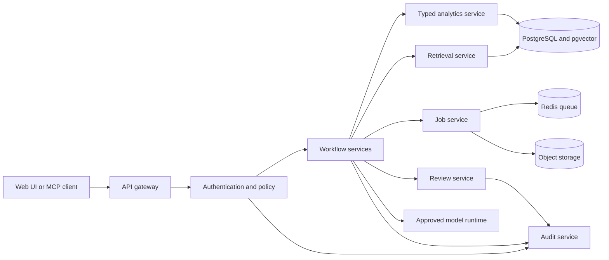

# Components and Boundaries

## Logical architecture



## Ownership table

| Component | Owns | Must not own |
|---|---|---|
| Web client | task UI, citations, review views, accessible state | tokens in browser storage, authorization decisions |
| API gateway | request validation, correlation IDs, rate limits | business rules or direct data access |
| Authentication and policy | identity, session, role and object checks, policy context | feature-specific ranking or generation |
| Job service | queues, leases, retries, cancellation, idempotency | silent infinite retry or final approval |
| Ingestion | quarantine, extraction, normalization, chunking, indexing | publication without validation |
| Retrieval | policy-filtered candidate generation, fusion, reranking | operational totals or unrestricted search |
| Analytics | allowlisted query patterns, metric definitions, provenance | generated SQL or arbitrary code execution |
| Catalog | normalized products, units, categories, price observations | policy interpretation |
| Detection | deterministic and model-assisted findings | final disposition |
| Drafting | template assembly, grounded fields, validation | publishing or inventing mandatory fields |
| Review | pending-output state machine and revisions | weakening underlying access policy |
| Model gateway | pinned models, timeouts, budgets, structured output | direct database or object-storage credentials |
| Audit | append-only security and workflow events, export | mutable source of truth for business data |

Feature modules call the central authentication and policy layer before reading data or invoking tools. Operational SQL is implemented only as parameterized statements in the analytics service.

## Synchronous request order

1. Resolve the authenticated server-side session.
2. Validate payload shape, size, locale, and requested workflow.
3. Build the policy context from workspace, role, object grants, sensitivity, and purpose.
4. Authorize the operation and requested objects.
5. Execute the bounded workflow with per-step deadlines.
6. Validate evidence, claims, and output schema.
7. Write the audit event before returning a consequential result.
8. Return the result with evidence locators, freshness, and review state.

## Durable jobs

Long ingestion, reindexing, vision, evaluation, export, and drafting work uses this state machine:

```text
accepted -> queued -> leased -> running -> validating -> succeeded
                       |          |            |
                       +----------+------------+-> retry_wait -> queued
                                                  -> failed_terminal
queued/running -> cancellation_requested -> cancelled
```

The idempotency scope is `(workspace_id, principal_id, job_type, idempotency_key)`. A request fingerprint prevents reuse of a key for different inputs. Workers renew leases, checkpoint resumable stages, cap attempts by error class, and write terminal audit events. Replayed callbacks and repeated submissions return the existing job.

## Trust boundaries

- The browser receives only opaque secure cookies and authorized response data.
- MCP sessions map to one authenticated principal and cannot share policy context.
- Model runtimes receive the minimum evidence and no infrastructure credentials.
- Extractors and converters run with restricted resources; their output remains quarantined until validation.
- Object access uses short-lived, audience-bound URLs issued after authorization.
- External systems connect through adapters with allowlisted destinations and redacted logs.

## Rubric coverage

This decomposition supplies the implementation boundary for A-T2-05/06/09/10, B-T2-05/06/07, B-T3-09/10, C-T2-05/09, C-T3-10, and D-T2-03/04. The required evidence is defined in `07-evaluation-and-release.md` and `10-rubric-traceability.md`.
