# Ten-Week Delivery and Review Plan

This is a staged delivery plan for the serious-pilot architecture. Weeks 1–8 produce the pilot release; weeks 9–10 provide controlled support, stabilization, and handover. Capacity and quality claims remain gated by measured evidence.

```mermaid
flowchart LR
  W1[W1 Contracts and safety] --> W2[W2 Data foundation]
  W2 --> W3[W3 Retrieval and analytics]
  W3 --> W4[W4 Detection and drafting]
  W4 --> W5[W5 Complete workflows]
  W5 --> W6[W6 Integration and security]
  W6 --> W7[W7 UAT, scale, recovery]
  W7 --> W8[W8 Staged release]
  W8 --> W9[W9 Pilot support]
  W9 --> W10[W10 Stabilize and hand over]
```

## Week 1 — contracts, evidence, and safe skeleton

**Deliver:** architecture decisions; entity and API contracts; identity and policy skeleton; audit schema; source/version lifecycle; evaluation manifests; sanitized functional fixtures; CI gates; threat model.

**Review and exit evidence:** boundary review, schema migration test, deny-by-default route tests, fixture provenance review, evaluation dry run, and approved decision log. No feature work may bypass the central security layer.

## Week 2 — ingestion, jobs, and model artifacts

**Deliver:** quarantine and extraction pipeline; OCR and table routing; bounded chunking; durable job state machine; object storage; real pinned multilingual embeddings; blue/green index publication.

**Review and exit evidence:** extraction benchmark by document class and language, idempotency/retry/cancellation tests, exact-span lineage samples, model digest manifest, version withdrawal and rollback exercise.

## Week 3 — retrieval, evidence Q&A, analytics, and discovery

**Deliver:** lexical/vector hybrid search; fusion and reranking; policy filters inside candidate queries; claim-level citations; abstention; governed analytics patterns; product normalization, matching, and reference-price flows.

**Review and exit evidence:** retrieval ablation; bilingual slices; citation verifier tests; current/as-of version tests; exact analytics reconciliation; invalid-query tests; discovery hard-constraint tests; pilot quality scorecard.

## Week 4 — detection, vision, drafting, and review

**Deliver:** listing text checks; bounded image checks; versioned sourcing rules; two drafting templates; approval queue; revisions; stale-evidence invalidation.

**Review and exit evidence:** labeled detection slice; vision precision slice; deterministic rule replay; draft reviewer exercise; transition and concurrency tests; zero-bypass suite; audit-chain samples.

## Week 5 — complete user journeys and integrations

**Deliver:** accessible task UI, evidence viewer, feedback capture, exports, MCP tools, integration adapters, admin views for data freshness, jobs, and evaluations.

**Review and exit evidence:** end-to-end journeys for each role and capability; keyboard/accessibility checks; session isolation tests; export authorization tests; integration timeout/retry tests; MCP parity checks.

## Week 6 — system integration, security, and release automation

**Deliver:** full observability; redaction; rate limits and budgets; deployment profiles; signed artifact flow; release scorecard automation; rollback controls.

**Review and exit evidence:** threat-model closure; authorization and injection campaigns; secret/dependency/container scans; audit-sink failure test; private-profile blocked-egress run; rollback rehearsal.

## Week 7 — UAT, serious scale, and recovery

**Deliver:** user-acceptance environment; representative 100,000-document and 250,000-product corpus; mixed-load harness; backup/restore automation; operations runbooks.

**Review and exit evidence:** user-acceptance disposition; p50/p95/p99 load report at 50 active users; database query plans; queue saturation and backpressure tests; measured recovery exercise; cost model and alert validation.

## Week 8 — staged pilot release and knowledge transfer

**Deliver:** limited production release; dashboards and alerts; operator, reviewer, administrator, developer, and evaluator guides; ownership and escalation map.

**Review and exit evidence:** signed pilot scorecard; deployment and rollback record; smoke tests; training completion; open-risk register with owner and date; day-one service review.

## Week 9 — supported operation

**Deliver:** daily service review, defect triage, reviewer calibration, relevance and abstention analysis, capacity observation, and controlled fixes.

**Review and exit evidence:** seven-day trend report; incident and defect dispositions; rerun of affected evaluation slices for every promoted fix; updated runbooks and known limitations.

## Week 10 — stabilization and handover

**Deliver:** remaining approved fixes; ownership transfer; final operational baseline; roadmap for expansion beyond the serious-pilot envelope.

**Review and exit evidence:** final acceptance record; unresolved-item register with explicit owner and expiry; recovery and rollback sign-off; 14-day soak outcome when calendar timing permits, otherwise a named post-handover gate that prevents broader promotion.

## Scope control

Authentication and authorization, evidence traceability, human approval, audit durability, test isolation, private-profile parity, recovery, and release gates cannot be compressed out of the schedule. If evidence shows the schedule is at risk, reduce the number of capability variants, integrations, categories, or templates while preserving the safety and evaluation foundation.

Weekly review uses `10-rubric-traceability.md`: update design status, attach implementation evidence, attach verified results, name blockers, and record the next decision. A criterion remains open until its evidence artifact exists.
