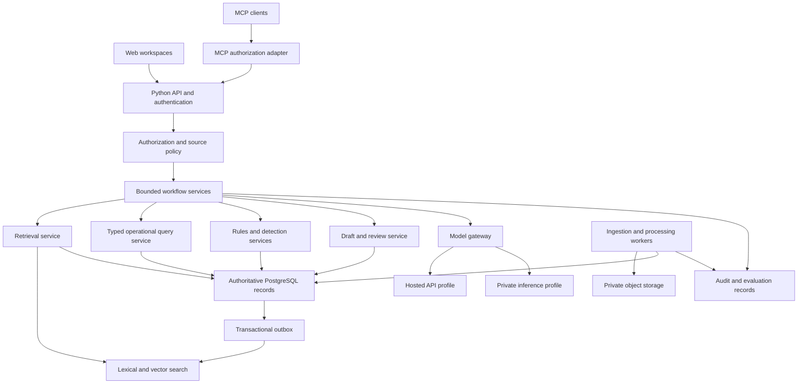

# Production RAG and Decision-Support Platform

## 1. Summary and design assumptions

Build a hypothetical platform for managing an equipment and services marketplace. It helps users understand policies, explore operational data, prepare reviewed documents, find suitable products, and investigate unusual listings or sourcing activity.

The platform has three workspaces:

| Workspace | Capabilities |
|---|---|
| Knowledge and analytics | Policy Q&A, guided operational queries, dashboards, downloadable reports |
| Catalog intelligence | Semantic discovery, product comparison, reference prices, listing-quality checks |
| Planning and review | Evidence-backed document drafting, sourcing-risk indicators, review queues |

All workspaces share identity, permissions, source provenance, audit records, evaluation infrastructure, and model access.

**Core architectural choice:** use bounded Python workflows. Use retrieval for documentary evidence, typed tools for operational facts, statistical models for price signals, supervised models for classification, and deterministic rules for sourcing indicators.

LangChain is unnecessary for the initial implementation. Explicit functions and typed interfaces make authorization, retries, provenance, and evaluation easier to inspect. MCP provides an integration interface; it does not control the internal workflow.

### Anonymization boundary

The implementation and documentation must be independently understandable as a fictional system.

- Exclude original names, acronyms, addresses, document titles, identifiers, dates, budgets, staffing tables, legal references, and source filenames.
- Use newly written examples and synthetic datasets, not lightly renamed excerpts.
- Do not commit the supplied document, extracted text, screenshots, embeddings, or a mapping back to the original material.
- Change the original initiative grouping, example scenarios, delivery schedule, sample sizes, and performance targets.
- Scan fixtures, generated documents, logs, screenshots, file metadata, and documentation before publication.
- Use role identifiers for ownership, without personal names.

Every numerical assumption below is a **new engineering planning assumption**, not a reproduced contractual requirement.

### Initial production envelope

| Dimension | Planning baseline |
|---|---|
| Knowledge corpus | 100,000 documents; approximately 1.2 million searchable chunks |
| Catalog | 250,000 active product/service listings |
| Operational data | 3 million historical transaction and sourcing records |
| Daily changes | 2,000 documents and 10,000 listing updates |
| Users | 50 active users; concurrency tested separately |
| Interactive traffic | 2 requests/second sustained; 8 requests/second for a two-minute burst |
| Languages | Indonesian, English, and mixed-language questions |
| Availability objective | 99.9% monthly for interactive services |
| Deployment profiles | Hosted model APIs; entirely private infrastructure and inference |
| Delivery estimate | Approximately 20 weeks with the staffing assumptions in Section 10 |

Concurrency describes connected users; request rate describes actual work. Capacity tests must exercise both.

The first release covers four fictional policy topics, five catalog categories, six analytics patterns, and four document templates. These are deliberate product limits despite the larger storage and traffic envelope.

---

## 2. Architecture and technology choices

### Component design



### Stack

| Layer | Selection | Reason |
|---|---|---|
| Backend | Python 3.12, FastAPI, Pydantic, SQLAlchemy, Alembic | Typed interfaces, asynchronous APIs, explicit database migrations |
| Dependency management | `uv`; Bun for frontend dependencies | Matches the workspace conventions |
| Frontend | React, TypeScript, Vite | Suitable for interactive search, review queues, charts, and source inspection |
| Authoritative database | PostgreSQL | Transactions, permissions, operational queries, review state, provenance |
| Search | PostgreSQL full-text search plus pgvector | Pilot-scale retrieval without a second cluster; OpenSearch is a later option |
| Background jobs | Celery with Redis; durable job state and outbox in PostgreSQL | Separates ingestion and long-running work from interactive requests |
| Document parsing | Docling with local OCR | Layout-aware extraction, tables, scanned documents |
| Object storage | S3-compatible API | Portable storage for originals, parsed artifacts, images, and exports |
| Embeddings | Pinned multilingual model, 1,024 dimensions | One embedding model across both deployment profiles |
| Reranking | Pinned multilingual reranker | Multilingual query–passage relevance scoring |
| Private generation | Pinned 32B-class model through vLLM | Explicitly configurable local inference |
| Private vision | Pinned vision model | Image–listing consistency checks |
| Hosted generation | Pinned hosted generation model | Initial answer, drafting, and vision candidate |
| Hosted intent parsing | Pinned small hosted model | Small, constrained intent-to-schema tasks |
| Observability | OpenTelemetry, Prometheus, Grafana | Self-hostable metrics and tracing |
| Testing | pytest, property-based tests, Playwright, Locust | Behavioral, authorization, browser, and capacity verification |

These are starting model classes, not claims that they already satisfy the domain evaluation gates. Pin model revisions and serving images after compatibility testing. Hosted model IDs and prices must be captured from the selected provider’s catalog when the release is frozen.

### Why separate search from PostgreSQL?

At the serious-pilot corpus (~1.2 million chunks), PostgreSQL with pgvector and full-text search is the initial retrieval architecture. A separate search cluster is deferred until measured PostgreSQL-only p95 retrieval misses latency targets with insufficient headroom, or measured production chunks are substantially above 1.2 million. The 1.2 million planning baseline is not itself an OpenSearch trigger.

Keep PostgreSQL authoritative for visibility, version status, and source content. OpenSearch supports filters inside vector queries, avoiding the recall problems of applying all filters only after retrieval. [OpenSearch filtering documentation](https://docs.opensearch.org/latest/vector-search/filter-search-knn/efficient-knn-filtering/)

The cost is an additional service and eventual consistency. Address that through an outbox, revision checks, reconciliation, and authorization rechecks.

Do not build OpenSearch for the first release. Introduce it only after the measured trigger above.

### Deployment profiles

| Concern | Hosted profile | Private profile |
|---|---|---|
| Generation | Approved external model API | vLLM endpoints inside the private network |
| Embeddings and reranking | Locally controlled inference | Locally controlled inference |
| Database | Managed PostgreSQL | Private PostgreSQL HA deployment |
| Search | PostgreSQL full-text + pgvector (OpenSearch deferred) | Same; private OpenSearch only after the measured trigger |
| Object storage | Private cloud bucket | Private S3-compatible storage |
| Identity | OIDC provider | Private OIDC provider |
| Telemetry | Controlled observability destination | Private observability only |
| Network | Explicit provider allowlist | No runtime Internet egress |
| Failure fallback | Another explicitly approved profile, if configured | Never fall back to an external API |

The private profile includes model files, OCR assets, fonts, package artifacts, and container images. Preload these through a controlled import process; ordinary application startup must not download them.

Local development must reuse the existing shared PostgreSQL and Redis services. Do not create duplicate local database containers. Reserve the next available application port block before implementation; the currently available block is 3130/8130, subject to a fresh registry check. The entirely private production profile follows the explicit deployment requirement rather than the inherited managed-database default.

---

## 3. Shared data foundation and RAG pipeline

### Source handling

| Source | Mechanism | Authority and freshness |
|---|---|---|
| Approved policies and procedures | Versioned document retrieval | Authoritative only within their recorded effective period |
| Curated FAQs | Retrieval linked to supporting policy sections | Useful entry points; cannot override policy |
| Historical planning documents | Restricted retrieval for drafting | Examples and precedents, not current policy authority |
| Product attributes | Search index plus authoritative record lookup | Current structured record wins over indexed text |
| Operational records | Parameterized read-only tools | Never answer live totals from document embeddings |
| External price observations | Scheduled approved connector | Evidence with timestamp and comparability metadata |
| Product images | Stored images plus vision processing | Untrusted content; observations require validation |
| Feedback | Separate reviewed labeling store | Not automatically promoted into the knowledge corpus |

### Minimum data model

Use UUIDs for internal identifiers and explicit revisions for mutable entities.

| Entity | Essential fields |
|---|---|
| Workspace | ID, configuration, deployment profile |
| Principal and membership | Subject ID, workspace, roles, group memberships |
| Source | ID, source type, authority class, owner role, ingestion policy |
| Document | ID, source ID, visibility, classification, lifecycle status |
| Document version | Document ID, content hash, object key, effective dates, parser version, approval state |
| Chunk | Version ID, heading path, text, page/span coordinates, table references, language |
| Search projection | Entity ID, source revision, embedding revision, index generation |
| Product | ID, category, normalized attributes, unit, currency, visibility, revision |
| Price observation | Product match, observed amount, unit, tax/shipping treatment, source, retrieval time |
| Operational record | Workspace-scoped domain fields and source revision |
| Detection finding | Entity revision, detector version, evidence, severity, review state |
| Draft and revision | Template version, input brief, content, evidence links, review state |
| Review decision | Exact revision hash, reviewer subject, decision, reason, timestamp |
| Job | Type, idempotency key, state, attempts, lease, progress, result reference |
| Interaction | Principal scope, request, response, outcome, source references, execution manifest |
| Feedback | Interaction/finding/draft reference, submitted label, reviewer disposition |
| Evaluation case/run | Dataset version, split, assertions, model manifest, results |

Use JSONB for variable product attributes and typed model output. Do not place every entity into an undifferentiated JSON table.

Operational facts remain normalized. Large files and rendered artifacts live in object storage.

### Ingestion lifecycle

```text
received
  → quarantined
  → extracted
  → validated
  → awaiting approval
  → approved
  → indexed
  → published

Any processing stage → failed → retry or manual repair
Published version → superseded or withdrawn
```

Implementation sequence:

1. **Validate intake.** Check file type, actual MIME signature, size, page count, decompression ratio, and malware status.
2. **Store immutable originals.** Calculate a content hash and assign a source revision.
3. **Parse locally.** Extract text, headings, tables, page coordinates, and images.
4. **Run OCR selectively.** Use OCR for scanned or unreliable text layers; record which pages required it.
5. **Detect suspicious structure.** Flag hidden text, unusual overlays, embedded instructions, and extraction disagreements for inspection. Detection is supplementary, not a security boundary.
6. **Normalize carefully.** Remove repeated page furniture while retaining section numbering, units, table headers, and footnotes.
7. **Apply metadata.** Assign authority, effective dates, language, classification, allowed groups, and topic coverage.
8. **Review publication.** Only approved sources become searchable in the relevant workspace.
9. **Chunk and embed.** Record parser, chunker, tokenizer, and embedding revisions.
10. **Publish through the outbox.** Commit canonical records and indexing events together.
11. **Reconcile.** Compare expected and indexed revisions, retry missing projections, and expose backlog age.

Docling’s document representation separates body content, tables, and page furniture; its OCR pipeline supports table extraction. Validate extraction quality against representative fixtures before committing to parser defaults. [Document representation](https://docling-project.github.io/docling/concepts/docling_document/), [OCR example](https://docling-project.github.io/docling/_generated/examples/full_page_ocr/)

### Chunking policy

Use structure-aware chunks rather than fixed character windows.

- Target 450–700 tokens for prose; hard maximum 900 tokens.
- Prefer section and paragraph boundaries.
- Allow up to 80 tokens of overlap only when a paragraph must be split.
- Preserve parent section identifiers and heading breadcrumbs.
- Keep short procedures and their exceptions together.
- Represent tables as rows with repeated headers, units, and a link to the complete table.
- Do not split a number from its unit, qualification, or footnote.
- Keep original-language text authoritative; optional translations are separate derived artifacts.
- Deduplicate by content hash within the relevant access boundary. Duplicate content must not accidentally combine permissions.

For large tables, use deterministic table queries or structured extraction. Do not expect semantic chunk retrieval to calculate totals reliably.

### Retrieval and answer sequence

1. Authenticate and derive access scope from the verified session.
2. Validate requested capability, language, question length, and filters.
3. Resolve conversational references using a bounded history window.
4. Classify scope: supported, clarification needed, or unsupported.
5. Build queries only for approved source classes and effective dates.
6. Retrieve the top 60 lexical and top 60 vector candidates.
7. Fuse ranks with reciprocal rank fusion, initially using `k = 60`.
8. Return candidate identifiers to the authorization layer.
9. Recheck current visibility, publication state, and source revision in PostgreSQL.
10. Fetch authorized text and rerank at most 40 candidates.
11. Select up to 10 diverse evidence passages, including required parent context.
12. Generate a structured answer from the selected evidence.
13. Validate citation IDs, quoted spans, numbers, and claim support.
14. Persist the final result and its execution manifest before returning completion.

Use an evidence budget of roughly 6,000 tokens for ordinary answers. Larger questions should be decomposed into a bounded sequence or ask the user to narrow the request.

A reranker score is not a calibrated probability. Select abstention thresholds using the development evaluation set and freeze them with the release.

### Evidence and citation contract

Each factual claim must reference evidence identifiers that the server supplied.

A citation includes:

```text
document_id
document_version_id
chunk_id
section_path
page_or_table_location
supporting_span
source_effective_date
authorized_viewer_url
```

The model may select evidence IDs; it may not invent source URLs. The server resolves links through an authenticated source viewer.

Verification has two layers:

- **Deterministic:** citation exists, source remains authorized, version is valid, referenced number/span exists.
- **Semantic:** a bounded verifier evaluates whether the evidence supports the claim.

Remove unsupported claims or abstain. Allow at most one repair attempt. A model-based verifier reduces errors but does not prove factual correctness; human evaluation remains necessary.

### Version changes and deletions

- Default to the current approved version.
- Support historical questions through an explicit “as of” date.
- When approved sources conflict, surface the conflict and request clarification.
- A withdrawal immediately blocks canonical access, even if the search index still contains a candidate.
- Recheck authorization before final delivery, export, and citation viewing.
- Blue/green index generations support re-embedding and rollback.
- Reindexing must never mix embedding models within one vector field.

---

## 4. Capability specifications

### A. Policy and procedure Q&A

Initial fictional topics:

- Account and role access.
- Listing submission and correction.
- Ordering and approval procedures.
- Service amendments and cancellations.

Behavior:

- Answer in the user’s language unless another language is requested.
- Cite the applicable approved sections.
- Distinguish requirements, recommendations, and historical examples.
- Ask for missing conditions that change the answer.
- Refuse questions outside the configured topic and source boundaries.
- Treat previous chat answers as conversation history, not authoritative evidence.
- Render simple process diagrams only from validated steps.
- Generate numerical charts only when an approved source contains the underlying data.

User states:

```text
ready → finding sources → validating answer → answered
                                     ↘ clarification required
                                     ↘ insufficient evidence
                                     ↘ temporarily unavailable
```

Show sources, effective dates, and an explicit limitation when only part of the question can be answered.

### B. Operational data assistant

Implement six query patterns:

1. Spending by period and category.
2. Order counts by status.
3. Supplier concentration within a selected category.
4. Product price variation over time.
5. Additional-service charges relative to base charges.
6. Participation and outcome summaries for sourcing events.

The language model produces an intent object, not executable SQL:

```json
{
  "pattern": "spending_by_period",
  "filters": {
    "start_date": "2030-01-01",
    "end_date": "2030-03-31",
    "category_ids": ["category-a"]
  },
  "group_by": ["month"],
  "presentation": "bar"
}
```

The server maps the pattern to a reviewed parameterized query.

Controls:

- Workspace and identity never come from model-generated arguments.
- Dimensions, measures, sorting, and date ranges use allowlists.
- Use a read-only database role, read-only transaction, and statement timeout.
- Return at most 500 rows interactively.
- Export larger approved results through a background job, with a 100,000-row initial cap.
- Snapshot exports so rows do not change partway through generation.
- Use decimal arithmetic for amounts.
- Show data freshness, applied filters, measurement units, and source report identity.
- Ask for clarification when a required date range or grouping is absent.
- Render narrative totals directly from query results where possible.
- Disable unrestricted SQL and Python execution.

The same validated result object powers the table, chart, narrative, and spreadsheet export.

### C. Evidence-backed document drafting

Support four fictional templates:

- Equipment requirements brief.
- Maintenance service specification.
- Installation work description.
- Recurring service scope.

Inputs include purpose, quantities, delivery constraints, acceptance conditions, known technical requirements, and explicit exclusions.

Workflow:

1. Validate the brief and identify missing mandatory fields.
2. Retrieve the current approved template.
3. Retrieve applicable policies separately from historical examples.
4. Retrieve up to five relevant historical documents.
5. Assemble an outline and evidence map.
6. Generate sections with bounded calls.
7. Validate template structure and required sections.
8. Check numerical consistency and cross-section contradictions.
9. Attach source justifications and unresolved assumptions.
10. Create a revision in `awaiting_review`.
11. Collect reviewer decisions against the exact revision hash.
12. Enable final export only after approval.

Approval rules:

- Authors cannot approve their own drafts.
- Any content edit creates a new revision and invalidates the previous approval.
- Approval requires optimistic concurrency checks.
- Required fields with unknown values remain visible placeholders; the model must not fill them by invention.
- Historical wording cannot override current policy.
- Unapproved documents can be inspected in a watermarked review view.
- Final downloadable files require an approved revision.

The application can enforce its export and integration paths. It cannot prevent a person from manually copying visible text; do not claim otherwise.

### D. Product discovery, matching, and comparison

Search combines:

- Exact identifiers and model codes.
- BM25 keyword relevance.
- Multilingual semantic relevance.
- Hard filters for category, price, availability, location, and technical constraints.

Hard filters run before ranking. Ranking cannot silently relax them.

Initial personalized ranking uses explicit user preferences, not inferred sensitive characteristics:

```text
final score =
    0.85 × relevance
  + 0.10 × declared preference compatibility
  + 0.05 × record completeness
```

Normalize features using the frozen development dataset. Without declared preferences, redistribute their weight to relevance.

Expose ranking explanations such as matching capacity, compatible dimensions, or selected delivery region.

Product matching:

- Normalize identifiers, brand/model fields, quantities, units, and variants.
- Treat verified identical identifiers as strong evidence, subject to variant checks.
- Use learned similarity thresholds for candidates without reliable identifiers.
- Keep `same_product`, `comparable_product`, and `not_comparable` distinct.
- Do not combine pack sizes, refurbished items, or service bundles as identical products.

Comparison:

- Fetch current attributes from PostgreSQL after search.
- Display unknown values as unknown.
- Show normalized and original units where conversion occurred.
- Include observation dates and source provenance.
- Use deterministic comparison tables; generated prose may summarize them.

### E. Reference prices and listing-quality checks

**Reference prices**

Use configured APIs or licensed feeds. The application must not autonomously browse arbitrary marketplaces.

Normalize:

- Currency and exchange-rate date.
- Unit and pack size.
- Tax inclusion.
- Shipping treatment.
- Product condition.
- Technical variant.
- Service scope.
- Observation date.

Publish a reference range only when at least three sufficiently comparable observations remain after filtering. Otherwise return `insufficient_comparables`.

Initial refresh target: 72 hours. Older observations may be displayed as historical evidence but cannot silently drive a current-price recommendation.

Use median and interquartile range with sample count. Label the result as an observed comparison range, not a guaranteed fair price.

**Listing checks**

| Check | Implementation |
|---|---|
| Specification consistency | Typed attribute rules plus a trained text-pair classifier for ambiguous descriptions |
| Category consistency | Supervised classifier over multilingual listing embeddings |
| Image consistency | Vision model observations compared with listing type and required visual characteristics |
| Product price | Auditable robust statistics within comparable cohorts |
| Additional-service charges | Configurable ratio and comparability rules |

Default product-price signal:

```text
Flag a high-price observation above Q3 + 3 × IQR
only when the comparable cohort has at least 30 observations.
```

For sparse or degenerate cohorts, return insufficient evidence rather than substituting an unexplained threshold.

Each result includes detector version, entity revision, observed values, cohort definition, explanation, and review state.

**Learning loop**

- Store reviewed labels separately from user feedback.
- Require at least 2,000 adjudicated examples before claiming supervised-detector readiness.
- Split by product family, supplier grouping, and time to reduce leakage.
- Retrain weekly only after at least 250 new reviewed labels accumulate.
- Train challengers offline.
- Promote only after frozen-holdout gates and reviewer approval.
- Retain rollback artifacts for every promoted detector.
- Never continuously rewrite production model weights from raw feedback.

### F. Sourcing-event advisory

Use deterministic rules over participant, offer, timing, and outcome data.

Initial fictional rules:

- Very low participation.
- Repeated award concentration within a category.
- Unusual clustering of submission times.
- Offer-price deviations from a comparable reference cohort.
- Repeated co-participation patterns requiring investigation.

Each rule has:

```text
rule_id
rule_version
required_fields
minimum_sample_size
predicate
severity
explanation_template
evidence_query
effective_period
```

Missing inputs produce `not_evaluable`, never a clean result.

Severity is an explicit prioritization score, not a probability of wrongdoing. Keep the rule outcomes visible even when presenting a combined severity.

The risk board supports:

```text
new → triaged → investigating → resolved
                       ↘ dismissed
```

Every state change requires a recorded actor and reason.

Deduplicate findings by event, rule version, and evidence window. Use a durable outbox for in-app alerts and record delivery attempts.

The system does not select winners, reject participants, suspend listings, or make accusations. Reviewers make the consequential decisions.

---

## 5. APIs, MCP, and trust boundaries

### Public API groups

| API | Purpose |
|---|---|
| `POST /v1/questions` | Start source-grounded Q&A |
| `POST /v1/analytics/queries` | Execute an approved operational pattern |
| `POST /v1/products/search` | Search with explicit constraints |
| `POST /v1/products/compare` | Compare current authoritative records |
| `GET /v1/products/{id}/references` | Inspect price observations and comparison range |
| `POST /v1/listing-checks` | Evaluate an authorized listing revision |
| `POST /v1/sourcing-evaluations` | Evaluate an authorized event revision |
| `POST /v1/drafts` | Create a drafting job |
| `POST /v1/drafts/{id}/reviews` | Record a human review decision |
| `POST /v1/drafts/{id}/exports` | Export an approved revision |
| `POST /v1/feedback` | Submit feedback on an existing result |
| `GET /v1/jobs/{id}` | Read durable job status |
| `GET /v1/jobs/{id}/events` | Resume progress events |
| `GET /v1/sources/{id}` | Open an authorized source version |
| `POST /v1/audit-exports` | Create a permission-controlled audit export |

Common response fields:

```text
request_id
status
result
evidence[]
warnings[]
execution_manifest_id
```

Use explicit statuses such as `answered`, `needs_clarification`, `insufficient_evidence`, `out_of_scope`, and `unavailable`. Do not represent an empty successful response as a valid answer.

Long-running endpoints return `202` and a durable job ID. Idempotency keys prevent duplicate drafts, evaluations, exports, and feedback submissions.

### MCP surface

Expose only these initial tools:

```text
search_knowledge(query, filters)
read_evidence(evidence_ids)
query_operational_data(pattern, filters, grouping)
search_products(query, constraints)
compare_products(product_ids)
get_price_references(product_id)
get_finding(finding_id)
get_draft_status(draft_id)
```

MCP clients cannot approve drafts, publish documents, change permissions, run SQL, execute code, send messages, or initiate arbitrary network requests.

Both MCP and REST call the same application services. Do not maintain separate business logic.

For remote MCP, validate token issuer, audience, expiry, and scopes; use the applicable OAuth discovery flow. Never forward an inbound MCP token unchanged to an upstream service. [MCP authorization specification](https://modelcontextprotocol.io/specification/2025-11-25/basic/authorization)

### Authorization design

- Derive principal and workspace from authenticated credentials.
- Use non-owner database roles without superuser or `BYPASSRLS`.
- Enable and force row-level security on workspace-owned tables.
- Restrict migration credentials to deployment tooling.
- Search filters enforce coarse permissions.
- Canonical rechecks enforce current permissions before text reaches the model.
- Object downloads, exports, source viewing, caches, and job results require the same authorization.
- Recheck permissions for queued jobs when execution starts and before delivery.
- Cache keys include workspace, permission fingerprint, corpus revision, query, and model/prompt revision.
- Permission changes invalidate affected caches and pending deliveries.

PostgreSQL table owners and privileged roles can bypass ordinary row-security behavior, so role design is part of the boundary. [PostgreSQL row-security documentation](https://www.postgresql.org/docs/current/ddl-rowsecurity.html)

### Untrusted-content handling

Retrieved documents, product descriptions, images, and external observations are data.

The model-facing generation process has no credentials or tools for database writes, arbitrary networking, email, shell commands, or approvals. The orchestration service chooses capabilities before introducing retrieved content.

A parser or “sanitizer” does not make document content trustworthy. Structural restrictions remain necessary after extraction.

Use server-side chart specifications and document renderers. Do not execute model-generated Python, JavaScript, HTML, or SQL.

---

## 6. Evaluation plan and release criteria

Maintain two distinct scorecards:

1. **Engineering decision quality:** adapted from the linked assessment.
2. **Observed system behavior:** executable tests, labeled evaluations, load tests, and operational evidence.

A well-written architecture decision does not demonstrate that a running system passes its acceptance tests.

### Dataset design

Create versioned datasets for:

- Retrieval.
- Complete answers.
- Structured analytics.
- Drafting.
- Product relevance and matching.
- Price comparability.
- Listing detection.
- Sourcing rules.
- Authorization.
- Injection and malformed-input attacks.

Each case records inputs, source snapshot, authorized identity, expected behavior, supporting evidence, forbidden behavior, tags, and adjudication history.

Separate development, calibration, and locked test sets by document family, product family, template family, and time. Paraphrases of one example belong in the same split.

Synthetic data is suitable for executable contracts and controlled failure cases. It cannot establish real-world detection quality or business value. Production acceptance requires representative authorized data.

### Proposed quality gates

| Area | Test population | Release gate |
|---|---|---|
| Retrieval | 600 answerable questions across topics and languages | Evidence Recall@20 ≥95%; report each language/topic slice |
| Policy Q&A | Same 600 cases, human adjudicated | Correct and adequately supported answers ≥92% overall; ≥90% per major slice |
| Citations | Claims and citations from Q&A set | Citation support precision ≥98%; citation coverage ≥95% |
| Abstention | 400 unsupported, missing-evidence, and conflicting-source cases | Correct abstention/clarification ≥99%; answerable-question over-refusal ≤8% |
| Analytics | 360 cases, 60 per pattern | Result correctness ≥98%; every returned numeric fact matches the query result |
| Analytics scope | 200 unsupported or malformed requests | No unapproved query execution |
| Discovery | 400 queries, 80 per category | Precision@5 ≥80% in every category; hard-constraint violation count = 0 |
| Product matching | 500 labeled pairs, including difficult variants | “Same product” precision ≥98%; recall reported separately |
| Reference prices | 200 comparability cases | Correct normalization and provenance in ≥98%; insufficient-data rules pass every boundary test |
| Listing detectors | ≥2,000 adjudicated cases, plus frozen holdout | Macro-F1 ≥85%; per-check precision ≥90%; report recall, abstention, and false positives |
| Vision checks | Dedicated image slice within detector set | Precision ≥90%; unsupported visual claims count toward failures |
| Sourcing rules | 300 executable event fixtures | Exact rule outcomes match all fixtures; every finding links to its rule and evidence |
| Draft usefulness | 100 briefs, 25 per template | ≥85% judged usable starting points; no invented mandatory factual values |
| Draft approval | State, concurrency, export, and replay tests | Zero application-path approval bypasses |
| Authorization | ≥1,000 role/resource/action combinations plus property tests | Zero unauthorized content exposure |
| Injection | ≥300 independently authored adversarial cases | Zero forbidden capability execution or unauthorized data delivery |
| Audit completeness | Reconciliation against accepted requests/jobs | Every accepted interaction has a durable final or explicit failure state |
| Private deployment | Full integration test with Internet egress blocked | All supported workflows operate; no external fallback |

A per-answer correctness judgment requires the right conclusion, relevant conditions, no material unsupported claim, and correct supporting sources. A response does not pass merely because it contains citations.

For draft usefulness, two reviewers independently assess completeness, factual discipline, internal consistency, and editing effort. A third reviewer adjudicates disagreements.

Report confidence intervals and denominators. Do not present “zero failures in the test set” as proof that the entire failure class is impossible.

### Diagnostic experiments

Run these ablations before tuning the complete workflow:

- BM25 only versus vectors only versus hybrid.
- Hybrid with and without reranking.
- Actual retrieval versus supplied gold evidence.
- Actual generation versus deterministic answer templates.
- Native-language versus cross-language retrieval.
- Current sources versus stale/conflicting sources.
- Default model versus challenger model.
- Full workflow versus individual stages.

Interpretation:

- Gold evidence fixes the answer → investigate ingestion or retrieval.
- Gold evidence still fails → investigate generation, instructions, or output validation.
- Correct answers remain unhelpful → investigate product workflow and presentation.
- Improvements occur only on development examples → investigate leakage or overfitting.

### CI and release execution

- Every change: schema, deterministic behavior, authorization, and unit tests.
- Relevant retrieval changes: retrieval evaluation.
- Prompt/model changes: answer quality, cost, and latency evaluation.
- Security-boundary changes: independent adversarial verification.
- Nightly: complete bilingual regression suite.
- Release candidate: frozen holdout, capacity tests, restore test, and profile-isolation tests.

A release fails if a hard security invariant fails, a quality gate falls below threshold, or normalized workflow cost rises more than 10% without an explicit reviewed budget change.

Statistical model tests need reproducible manifests and repeated runs; a single favorable run is insufficient.

---

## 7. Adapted evaluation criteria from the linked fieldbook

The following adapts all 44 items from the provided engineering assessment to this fictional platform. It preserves item identifiers for traceability while replacing the original scenarios.

### Common scoring

| Score | Adapted interpretation |
|---|---|
| 0 | No committed decision, unsupported assertion, or technology list without reasoning |
| 2 | Defensible choice with the principal cost or limitation identified |
| 4 | Committed choice, a credible alternative, evidence supporting the choice, and an observable reconsideration trigger |

Intermediate scores are permitted. Missing required evidence caps a decision at 2. Inconsistent assumptions reduce the later item’s score.

Use Tier 1 for bounded initial decisions, Tier 2 for production tradeoffs, and Tier 3 for adaptation after contrary evidence.

The fieldbook contains conflicting wording about planning scores and acceptance. This plan follows its separate evidence-based close-out approach: reasoning scores evaluate decisions; system gates evaluate behavior.

### A. AI application engineering — 14 criteria

| ID | Project-specific criterion | Required evidence |
|---|---|---|
| A-T1-01 | Choose native PDF extraction, OCR, or vision processing based on document quality and cost. | Comparison for short documents, long documents, and scanned tables, with measured processing cost and failure modes. |
| A-T1-02 | Assign each source to retrieval, a typed tool, or exclusion according to authority, freshness, and permissions. | Source-mechanism matrix from Section 3, verified against fixtures. |
| A-T1-03 | Build a small first evaluation that can fail for a concrete defect. | Labeled fixtures, assertions, thresholds, and an intentionally broken implementation that fails. |
| A-T1-04 | Justify supervised listing classifiers using label quality and stable categories. | Label audit, temporal holdout, leakage analysis, and comparison with prompting. |
| A-T2-05 | Enforce access below model-generated arguments. | Endpoint signatures, database roles, and a reachable/blocked resource matrix. |
| A-T2-06 | Prevent retrieved instructions from enabling forbidden actions. | Tool inventory, execution boundaries, and adversarial capability-reachability tests. |
| A-T2-07 | Define exactly what “wrong” means for each capability. | Sampling frame, grading rubric, exclusions, reviewer effort, and disagreement handling. |
| A-T2-08 | Set input, output, retry, and escalation budgets before model execution. | Per-workflow token arithmetic and an observable routing policy. |
| A-T2-09 | Make an unauthorized retrieval or stale answer reconstructable. | Trace fields, source revisions, retention policy, and a detector query. |
| A-T2-10 | Choose fixed workflows and isolate any bounded discretionary step. | Ordered execution sequence, iteration limits, and terminal failure behavior. |
| A-T3-11 | Diagnose whether disappointing results arise from retrieval, generation, product design, or unrealistic goals. | Stratified trace review, user-edit analysis, and a remediation branch for each finding. |
| A-T3-12 | Prevent prompt changes from silently increasing cost or reducing quality. | Versioned prompts, paired evaluations, merge gates, and an audited override mechanism. |
| A-T3-13 | Optimize the stage actually responsible for latency. | Stage timings, ranked interventions, and quality checks attached to each experiment. |
| A-T3-14 | Choose retraining, prompt changes, escalation, or abstention from observed error patterns. | Independently labeled holdout and error distribution, including rare cases. |

### B. Software engineering — 11 criteria

| ID | Project-specific criterion | Required evidence |
|---|---|---|
| B-T1-01 | Make uploads and jobs survive disconnection, refresh, and process failure. | State machine, idempotency behavior, and restart/replay tests. |
| B-T1-02 | Store operational results, revisions, evidence, and feedback with appropriate lifetimes. | Entity model, indexes, access patterns, and retention schedule. |
| B-T1-03 | Keep production credentials outside developer and coding-agent environments. | Credential provisioning/rotation process and network-access verification. |
| B-T2-04 | Select the smallest architecture that satisfies the chosen scale and private profile. | Component diagram and deferred components with measurable introduction triggers. |
| B-T2-05 | Compare colocated vectors, dedicated search, and lexical-only retrieval. | Operational cost, consistency, recall, and workload benchmark comparison. |
| B-T2-06 | Design useful waiting, navigation, retry, cancellation, and failure states. | UI state table linked to durable backend job states. |
| B-T2-07 | Bound parser and renderer execution by network, filesystem, credentials, and resources. | Containment configuration and tests that attempt prohibited access. |
| B-T2-08 | Size concurrency and define visible behavior during throttling. | Arrival-rate arithmetic, bounded queues, and overload tests. |
| B-T3-09 | Reassess component boundaries when deployment independence or scaling fails. | Dependency measurements and explicit keep/split/recombine criteria. |
| B-T3-10 | Change schemas and search generations without losing permissions or evidence. | Expand/backfill/validate/switch/retire sequence with reconciliation checks. |
| B-T3-11 | Prevent test growth from making verification impractical. | Test-duration profile, duplication analysis, and a CI runtime budget. |

### C. Coding-agent workflow — 12 criteria

| ID | Project-specific criterion | Required evidence |
|---|---|---|
| C-T1-01 | Specify expensive-to-change contracts before implementation while leaving cosmetic details flexible. | Bounded implementation briefs and a list of deliberately deferred details. |
| C-T1-02 | Make source authority, authorization, and workflow boundaries discoverable. | Concise module map and entry-point documentation. |
| C-T1-03 | Review behavior and consequential boundaries before presentation details. | Review sequence prioritizing access, writes, exports, and source correctness. |
| C-T1-04 | Keep standing repository guidance short, actionable, and maintained. | Proposed instruction content, explicit exclusions, and an owner role. |
| C-T2-05 | Decompose work into independently verifiable changes. | Task dependency map and a closing test for every work package. |
| C-T2-06 | Enforce coding-agent permissions through the environment. | Allowed operations, human-controlled operations, and unreachable production resources. |
| C-T2-07 | Allocate review attention with mechanical risk classification. | Rules based on security paths, migrations, model changes, and periodic sampling. |
| C-T2-08 | Separate implementation from independent security verification. | Ownership split and adversarial cases produced outside the implementation work. |
| C-T2-09 | Turn recurring mistakes into enforceable checks. | Chosen lint, contract test, or authorization property, with its placement in the development loop. |
| C-T3-10 | Detect work that passes tests while violating architectural intent. | Dependency checks forbidding bypasses of authorization and typed query services. |
| C-T3-11 | Use parallel coding agents only when integration work remains manageable. | Isolation and merge protocol, shared decision record, and a measured stop condition. |
| C-T3-12 | Test invariants beyond the attack examples already known. | Independently generated attacks, capability restrictions, and production detection. |

This rubric item does not itself authorize parallel agents. Any future delegation remains a separate execution decision.

### D. Product and delivery judgment — 7 criteria

| ID | Project-specific criterion | Required evidence |
|---|---|---|
| D-T1-01 | Test whether users’ tasks are answerable from available data and whether assistance saves time. | Falsifiable assumptions and short task-observation studies. |
| D-T1-02 | Make demonstrations real where uncertainty matters. | Real-versus-simulated inventory and the hypothesis each demonstration tests. |
| D-T2-03 | Evaluate cost relative to completed useful work and control unexplained increases. | Cost per accepted answer/draft and comparison with measured user effort. |
| D-T2-04 | Treat unexpected usage as both a risk signal and a possible product need. | Usage observation, immediate mitigation, and a small validation experiment. |
| D-T2-05 | Decide what to build, adopt, and defer when usage expands. | Build/adopt/defer table protecting evidence quality and the user-feedback loop. |
| D-T3-06 | Recommend continuation, redirection, or stopping using separate value, quality, and risk decisions. | Decision memo with measurable continuation and stop conditions. |
| D-T3-07 | Attach important measurements to workflows the team already performs. | Owned merge/release/incident checks and indicators that the practice is deteriorating. |

### Close-out record

Every applicable decision must have:

```text
decision_id
selected_option
alternative_considered
reason
measurable_gate
evidence_location
owner_role
dependencies
review_milestone
early_reconsideration_trigger
status
```

Allowed statuses: `planned`, `implemented_unverified`, `verified`, and `blocked`.

A criterion may be `not_applicable` only with a reason and a trigger that would make it applicable.

---

## 8. Capacity, latency, and cost

### Performance objectives

Measure completion latency separately from progress indicators.

| Operation | Initial objective |
|---|---|
| Product search | p95 ≤2 seconds |
| Product comparison | p95 ≤2 seconds |
| Q&A | Progress acknowledgement ≤1 second; validated answer p95 ≤10 seconds |
| Analytics | p95 ≤5 seconds for approved interactive patterns |
| Draft generation | Job acknowledgement ≤1 second; completed draft p95 ≤60 seconds |
| Rule evaluation | p95 ≤3 seconds for an already-ingested event |
| Image consistency check | p95 ≤8 seconds per image |
| In-app alert | p95 ≤60 seconds after a committed trigger |
| Permission revocation | Effective before the next content delivery; final-delivery recheck required |

Do not stream unverified factual prose as an authoritative answer. Stream progress first; publish validated content after checks.

### Storage estimate

Serious-pilot envelope (Section 1): ~100,000 documents, ~1.2 million chunks, 250,000 products, 50 users, ~2 QPS sustained. Retrieval stays in PostgreSQL + pgvector; OpenSearch is deferred (Section 2). This arithmetic is a planning envelope. It is not a claim that this repository ingested 100,000 documents.

For 1.2 million vectors at 1,024 float32 dimensions:

```text
1,200,000 × 1,024 × 4 bytes
= 4,915,200,000 bytes
= 4.9152 GB of raw vectors
```

This excludes HNSW/ivfflat structures, lexical indexes, stored text, replicas, deleted revisions, and reindexing headroom. Plan several times the raw vector bytes for a working PostgreSQL data directory.

Starting benchmark topology:

- PostgreSQL 16 + pgvector as the only search/vector store, starting at 8 vCPU and 32 GB RAM, with HA and a reporting replica.
- One replica for production tables/indexes (PostgreSQL physical or managed replica), not a separate search cluster.
- At least two application replicas across failure domains.
- Separate ingestion, generation, detector, and export worker pools.
- Object storage budgeted independently; at 2 MB per original document, 100,000 originals are about 200 GB.
- Catalog rows for 250,000 products are small relative to vectors and originals.

These are benchmark starting allocations, not certified capacity. Do not stand up OpenSearch until the measured trigger in Section 2.

### Model throughput sizing

Interactive traffic is ~2 requests/second sustained (8 requests/second for a two-minute burst). Not every request calls a hosted generator: product search and health checks use local retrieval.

Hosted-call volume for a workflow:

```text
monthly_calls =
  qps × active_seconds_per_month × hosted_call_share × calls_per_request
```

The budget table below states the shares. Ingestion embedding of 1.2 million chunks is a local/offline cost (the selected multilingual model in both profiles) and is not included in hosted generation spend.

If the Q&A share is 0.15 of the 2 QPS mix and average aggregate output is 650 tokens per Q&A workflow:

```text
Required Q&A output throughput = 0.15 × 2 × 650
= 195 tokens/second
```

Input-prefill throughput and concurrent context memory must also pass.

Benchmark a private generation replica using the selected GPU class, pinned model, and the real evaluation workload. Calculate deployment size as:

```text
replicas = max(
  2,
  ceil(target_requests_per_second /
       measured_requests_per_second_per_replica_at_target_latency / 0.65)
)
```

`target_requests_per_second` is the hosted-generation share (Q&A/draft/vision), not the full 2 QPS mix. Perform equivalent sizing for embeddings, reranking, and vision. Do not assume they can share busy generation GPUs without measuring interference.

The final replica count is determined by this fixed sizing procedure after a measured private benchmark, not by an implementer’s guess and not by a synthetic GPU soak in this repository.

### Queue behavior

- Reserve separate concurrency pools for interactive and batch work.
- Bound the interactive pending queue to 200 jobs (~100 seconds of backlog at 2 QPS).
- Reject excess work with `429` and `Retry-After`.
- Expire an interactive job that cannot start within 15 seconds.
- Preserve accepted draft jobs with visible queued status.
- Retry transient provider failures with jitter and a maximum of two retries.
- Do not retry validation errors or permission failures.
- Use circuit breakers for provider outages.
- Keep job leases, checkpoints, and idempotency in PostgreSQL.

Celery deliveries can be repeated; workers must be idempotent rather than assuming exactly-once execution. [Celery task documentation](https://docs.celeryq.dev/en/stable/userguide/tasks.html)

### Illustrative hosted inference budget

The following includes aggregate model tokens across generation and verification steps. It assumes no cache discount. Monthly workflow counts use the formula above with a 30-day month (2,592,000 seconds) and 2 QPS sustained:

| Workflow | Hosted-call share | Calls / request | Monthly volume | Average input/output tokens | Approximate cost |
|---|---:|---:|---:|---:|---:|
| Q&A | 0.15 of 2 QPS | 1 | 777,600 | 10,000 / 650 | $18,585 |
| Analytics intent parsing | 0.05 of 2 QPS | 1 | 259,200 | 2,000 / 150 | $1,270 |
| Drafting | job traffic, not QPS | — | 2,000 | 32,000 / 4,500 | $182 |
| Selected vision checks | 0.02 of 2 QPS | 1 | 103,680 | 2,000 / 150 | $508 |
| **Subtotal** | | | | | **$20,545** |
| **25% reserve** | | | | | **$5,136** |
| **Illustrative inference allowance** | | | | | **$25,681/month** |

Remaining interactive QPS (product search, comparison, rule evaluation, health) is assumed not to call hosted generation.

Arithmetic uses a reference hosted-model assumption of $2 input / $6 output per million tokens (standard context, no cache discount). This is an engineering planning assumption, not a quote. Image tokenization, cached-input rates, and actual workflow usage must be metered. Ingestion, local embeddings/reranking, databases, object storage, private inference, network, and staff are separate.

Initial per-workflow budget limits (expected cost at the token averages above is lower):

- Q&A: $0.04 (about $0.0239 at 10,000 / 650).
- Analytics intent parsing: $0.01 (about $0.0049 at 2,000 / 150).
- Drafting: $0.15 (about $0.091 at 32,000 / 4,500).
- Vision check: $0.01 (about $0.0049 at 2,000 / 150).

Reserve expected cost before executing retries or additional calls. Under budget pressure, pause batch work first. Never silently switch to an unvalidated model or an externally hosted model in the private profile.

Local latency evidence is `scripts/load_capture.py` against a live API (fixture or hosted). It is not a 100,000-document ingest or a GPU soak. Restore/failover evidence is `scripts/restore.sh`. Full-scale acceptance remains unverified until those measurements exist on representative data.

---

## 9. Operations, monitoring, and recovery

### Trace and audit content

Record:

- Request/job IDs and timestamps.
- Pseudonymous principal and workspace.
- Effective permission fingerprint.
- Capability and intent.
- Source IDs, versions, owning workspace, and authorization decisions.
- Retrieval parameters and selected evidence.
- Prompt, model, parser, embedding, reranker, and rule versions.
- Stage durations and retry counts.
- Input/output tokens and attributed cost.
- Validation outcome.
- Final answer or explicit failure.
- Feedback and review references.

Do not store hidden model reasoning. Record observable inputs, outputs, structured checks, and evidence.

Use encrypted restricted payload storage for question/answer content. Keep operational metrics free of document content.

Initial hypothetical retention:

| Record | Retention |
|---|---|
| Detailed interaction payload | 90 days |
| Operational traces | 30 days |
| Audit metadata and approval history | 1 year |
| Approved source versions | Active lifetime plus 1 year |
| Sanitized evaluation fixtures | Until superseded, with version history |
| Backups | 35 days |

Actual deployment obligations may change these periods. Implement retention and deletion as explicit policies, including search projections, object artifacts, caches, and backup expiry.

### Standing detectors

Alert on:

- Unauthorized candidate surviving the canonical permission check.
- Source revision mismatch at delivery.
- Missing final audit state.
- Indexing lag exceeding 15 minutes for document updates.
- Listing update lag exceeding 5 minutes.
- Price observations passing their freshness limit.
- Elevated abstention or unsupported-claim rate.
- Provider errors, queue age, and rejected requests.
- Cost per workflow rising more than 20% from the rolling baseline.
- Unapproved draft export attempts.
- Any external network attempt in the private profile.

### Failure behavior

| Failure | Product behavior |
|---|---|
| Search unavailable | Explain that source-backed answers are temporarily unavailable |
| Generator unavailable | Offer authorized search results without generating an answer |
| Operational data stale | Show freshness and block requests requiring current values |
| Price feed stale | Display historical observations with a warning; suppress current recommendation |
| Parser failure | Keep the document unpublished and expose a repair task |
| Audit persistence unavailable | Do not return an unaudited successful result |
| Permission revoked mid-job | Terminate delivery and record a restricted outcome |
| Review service failure | Preserve draft; final export remains unavailable |

### Recovery and rollout

- Use expand/backfill/validate/contract database migrations.
- Treat search indexes as rebuildable projections.
- Preserve source snapshots needed to reproduce released answers.
- Test backup restoration before launch.
- Set recovery objectives of RPO ≤15 minutes and RTO ≤2 hours.
- Require the tested recovery path to include database, object metadata, permissions, model manifests, and search availability—not only database restoration.
- Deploy through internal use, shadow traffic, a 5% canary, 25%, and full release.
- Hold each stage until its quality and operational gates pass.
- Run at least a 14-day soak before broad release.

Immediately halt an affected capability for unauthorized disclosure, approval bypass, or unsupported consequential output. Roll back the model/prompt/index manifest independently where possible.

---

## 10. Implementation sequence and acceptance

### Staffing assumption

The schedule assumes approximately six full-time engineers covering backend, data/retrieval, ML, frontend, and platform/testing, plus part-time domain reviewers and independent security review.

A smaller team should extend the schedule. The plan does not assume that coding agents eliminate integration, labeling, or review work.

### Work packages

| Period | Work package | Concrete completion evidence |
|---|---|---|
| Weeks 1–2 | Repository foundation, synthetic scenario, identity, model gateway, deployment skeleton | Both profiles boot; authentication works; private egress test passes; first failing eval exists |
| Weeks 3–4 | Data model, ingestion, parsing, source approval, object storage, outbox | Restartable ingestion; approved source becomes searchable; withdrawn source becomes inaccessible |
| Weeks 5–6 | Hybrid retrieval, citation contract, Q&A, source viewer | Bilingual retrieval baseline and initial answer evaluation pass |
| Weeks 7–8 | Analytics patterns, dashboards, report exports | All six patterns match deterministic reference results; no unrestricted SQL path |
| Weeks 9–10 | Product search, comparison, matching, price connectors | Relevance benchmark, unit normalization, stale-price behavior, and provenance tests |
| Weeks 11–12 | Listing checks, rule engine, reviewer queues, labels | Detector holdout report, deterministic rule tests, feedback-to-training workflow |
| Weeks 13–14 | Draft workflows, section generation, review state, exports | All four templates work; approval/edit/concurrency bypass tests pass |
| Weeks 15–16 | Full integration, MCP, complete rubric evidence, adversarial evaluation | Shared service contracts pass through REST and MCP; independent attack report |
| Weeks 17–18 | Full-scale loading, model sizing, capacity tuning, recovery | Load report, private throughput sizing, successful restore and failover exercise. **This repo:** `scripts/load_capture.py` (live API p50/p95, not 100k ingest) and `scripts/restore.sh` (isolated restore on compose Postgres 55432). Full-scale corpus load and private GPU sizing remain **unverified**. |
| Weeks 19–20 | Soak, canary rollout, documentation, operator exercises | Release scorecard, operational runbooks, completed evidence records. **This repo:** operator restore/load-capture runbooks. Soak, canary, and a production release scorecard remain **unverified**. |

Identity, provenance, evaluation, and authorization must precede capability expansion. Do not postpone these as hardening work.

### Proposed repository organization

```text
backend/
  api/
  domain/
  workflows/
  retrieval/
  analytics/
  catalog/
  detection/
  drafting/
  ingestion/
  integrations/
  model_gateway/
  observability/

web/
evals/
tests/
infra/
docs/
```

Keep authorization and canonical data access centralized. Add dependency checks that prevent feature modules from bypassing those services.

Repository instructions should document test commands, module boundaries, data restrictions, and dangerous operations. Do not automatically create or derive a `CLAUDE.md` file.

### Build, adopt, and defer

| Decision | Treatment |
|---|---|
| Domain workflows, provenance, evaluation cases | Build |
| Authentication protocol and identity system | Adopt an OIDC implementation |
| Search engine, database, object storage, job framework | Adopt |
| General autonomous agent loop | Defer; requires a demonstrated task that bounded workflows cannot satisfy |
| Arbitrary SQL or Python tools | Exclude from the initial product |
| Graph database | Defer until relational/network feature queries demonstrably fail |
| Generator fine-tuning | Defer until error analysis shows a repeatable generation problem that retrieval/prompt changes do not solve |
| Automatic production model promotion | Exclude; use reviewed challenger promotion |
| Automatic external publication or consequential actions | Exclude |
| Arbitrary web crawling | Exclude; use configured data connectors |

### Required handover artifacts

- Architecture and decision records.
- Source authority and access-control model.
- OpenAPI and MCP contracts.
- Versioned synthetic datasets and fixture generators.
- Evaluation datasets, rubrics, and executable runners.
- Model and detector cards.
- Capacity and cost reports.
- Threat model and adversarial verification results.
- Deployment, rollback, backup, and restore procedures.
- Reviewer and operator guides.
- Completed close-out records for applicable assessment items.

**Completion means** every workspace works end to end, both deployment profiles pass their own evaluations, production-scale tests meet the stated envelope, review and authorization boundaries hold, and the anonymized documentation contains no original-source identifiers. A demonstration, passing unit suite, or high rubric score alone is insufficient.
